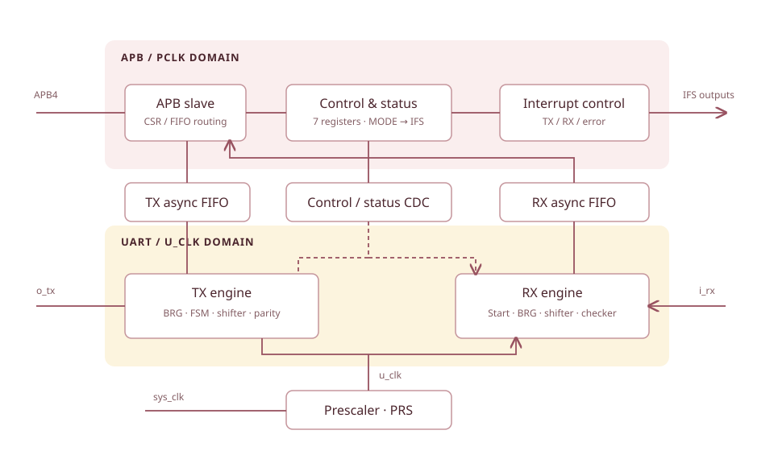

# RTL architecture

VSUART separates bus access, serial transmission, and serial reception. A prescaler produces `u_clk`; asynchronous FIFOs and CDC logic move data, configuration, and status between clock domains.

<div class="diagram" markdown>



</div>

This is a functional summary of the source structure. See the [original block diagram in FunctionalSpec, Figure 1-1](../downloads/VSUART_FunctionalSpec.pdf#page=5).

## APB, control, and status

| Module | Responsibility |
| --- | --- |
| `vsuart_apb_slv` | Route APB accesses to the CSR bank or FIFO data port; generate responses |
| `vsuart_reg` | Implement MODE, CR, STA, PRS, BRG, IE, IFS, and write guards |
| `vsuart_ifs` | Generate interrupt outputs from flags and enables |
| `vsuart_prs` | Divide `sys_clk` into `u_clk` using PRS |
| `vsuart_sync_a2u` | Transfer configuration/control from APB to UART |
| `vsuart_sync_u2a` | Transfer status/events from UART to APB |

## TX datapath

```text
APB write @ 0xFFFF → TX asynchronous FIFO → parallel-to-serial shifter
                                               ↓
                         parity + controller + bit counter → TX generator → o_tx
```

- `vsuart_tx_brg` generates transmit baud enables.
- `vsuart_tx_ctrl` handles idle, start, data, parity, and stop states.
- `vsuart_tx_p2s_shifter` serializes the payload.
- `vsuart_tx_parity` generates parity when selected by the frame format.
- `vsuart_tx_gen` selects the output line value for each frame phase.

The TX FIFO is an `asc_fifo` instance in the top module. It accepts APB-domain writes and supplies UART-domain reads. MODE selects the frame format.

## RX datapath

```text
i_rx → start detector → sampled serial-to-parallel shifter → RX FIFO → APB read
                              ↓
                         parity/frame checker → status / error
```

`vsuart_rx_start` detects the start condition; `vsuart_rx_brg` controls sampling. The controller, bit counter, and `vsuart_rx_s2p_shifter` assemble data. `vsuart_rx_checker` checks parity and stop bits; `vsuart_rx_fifo` buffers received data and provides status.

## Clock-domain crossings

DesignSpec §1.2 records two changes to reused common modules:

- Handshake-based CDC for transfers from a faster clock domain to a slower domain.
- Additional character-count information in the asynchronous FIFO.

Shared RTL is under `0_rtl/common/`, including `cdc_unit`, `cdc_unit_hs`, `edge_det`, `bit_cnt`, register primitives, and `asc_fifo/`.

FunctionalSpec requires **`Fsys > Fpclk > Fu`**. The presence of CDC modules describes structure; timing closure and CDC sign-off require separate evidence.

## Top-level parameters

| `vsuart` parameter | Default in `0_rtl/vsuart.v` |
| --- | --- |
| `ADDR_W` | 16 |
| `DATA_W` | 32 |
| `FIFO_DEPTH` | 128 |
| `FIFO_DATA_W` | 9 |
| `STRB_W` | `DATA_W / 8`; source comment says not to override directly |

`vsuart_define.v` also contains a `FIFO_DEPTH=32` macro. The testbench instantiates the top without parameter overrides, so the top default applies to that instance. Check the elaborated parameters when integrating the IP.

!!! info "Design document maturity"
    DesignSpec revision 0.01 contains an older hierarchy, repeated entries, and incomplete detailed sections. The module names above were checked against the RTL. Implementation descriptions supplement the PDF rather than quoting missing sections.

Sources: [DesignSpec §1, PDF pp. 4–5](../downloads/VSUART_DesignSpec.pdf#page=4), [FunctionalSpec §1.2, PDF pp. 5–6](../downloads/VSUART_FunctionalSpec.pdf#page=5), `0_rtl/vsuart.v`, `vsuart_tx.v`, `vsuart_rx.v`, and `vsuart_define.v`.
